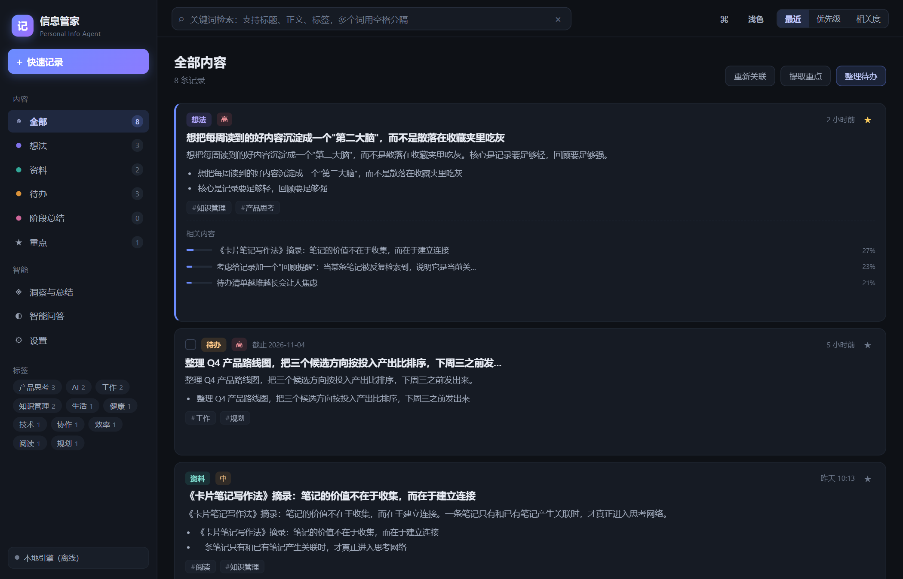
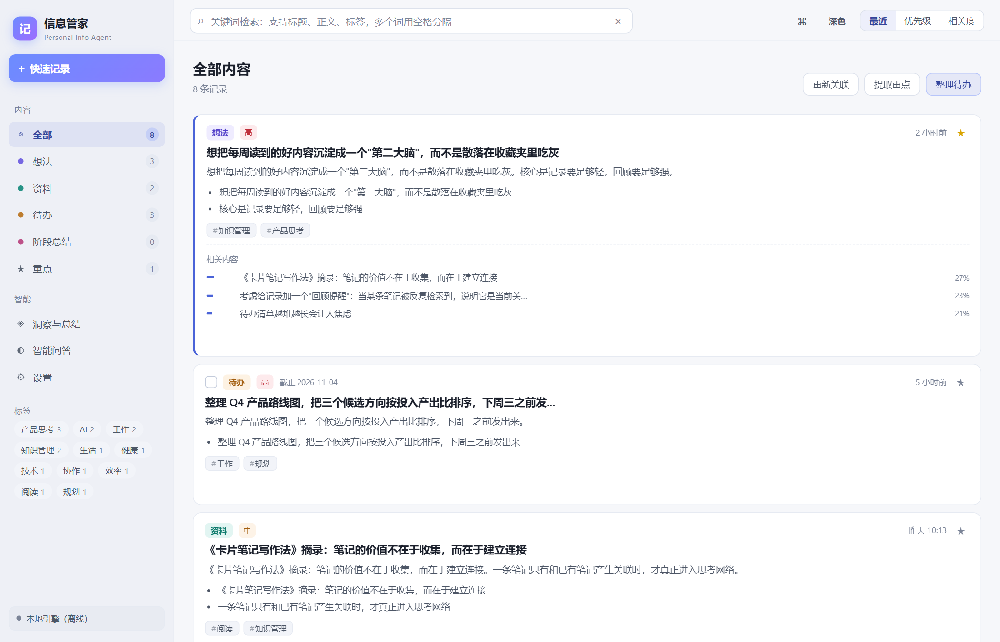
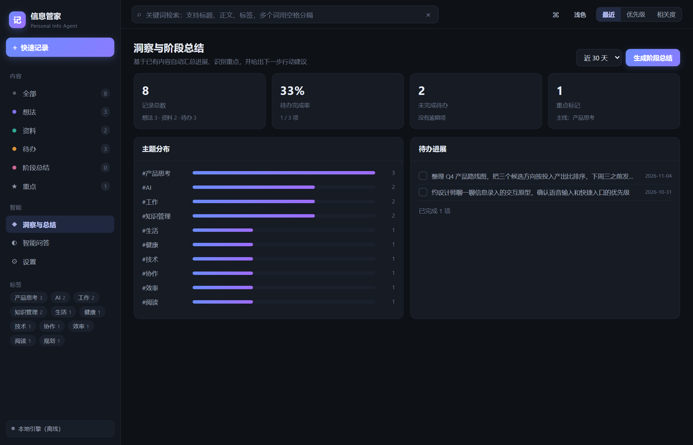
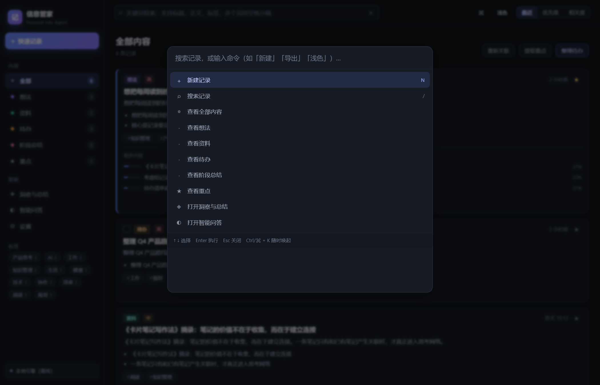

# 信息管家 · Info Butler

> 本地优先的个人信息知识库。随手记录，自动分类打标签，能检索、能关联、能问答、能出阶段总结。
> **数据只存在你自己的电脑里**，不注册、不上传、断网可用。

[](https://github.com/regdiliKUN/info-butler/actions/workflows/ci.yml)



<p align="center">
  
  
</p>



---

## 它解决什么问题

笔记软件的通病是「记录很轻，回顾很重」：收藏夹越堆越满，需要的时候一条都找不到。
信息管家把重心放在**入库之后的自动化**上：

| 你在做的事 | 它会自动做的事 |
| --- | --- |
| 随手写一段话 | 判断是想法 / 资料 / 待办，生成标题、摘要、要点、标签、优先级、截止日期 |
| 记第二十条相关内容 | 和前面相关的记录互相建立关联，卡片底部直接给出「相关内容」 |
| 想找「上次说的那个方案」 | 关键词、短语、语义意图三路召回，命中处高亮 |
| 想知道这周推进了什么 | 一键生成五段式阶段总结：概览 / 主题 / 重点 / 待办 / 建议 |
| 想问「还有哪些没做完的」 | 先在你的记录里检索，再交给大模型作答，答案标注引用来源 |

**没有 API Key 也能用**：内置一个纯离线的中文检索引擎（分词 / TF-IDF / 意图识别 / 抽取式摘要），
配置大模型后自动切换到更强的能力，配置失败会无感回退，功能不中断。

## 快速开始

### 方式一：单文件 exe（Windows，推荐给最终用户）

双击 `信息管家.exe`，会启动本地服务并自动打开浏览器。关闭那个窗口即停止服务。
不依赖 Node.js / Python，任何 Windows 10/11 x64 电脑可直接运行。

```
信息管家.exe --port 5000      # 换端口（默认 4173）
信息管家.exe --no-browser     # 只起服务不打开浏览器
信息管家.exe --help
```

### 方式二：源码运行（任意平台）

```bash
npm install          # 只为开发/测试，运行时零依赖
npm run serve        # http://127.0.0.1:4180/
```

也可以直接双击 `src/index.html`（`file://` 下部分浏览器会限制 localStorage，建议用上面的服务方式）。

## 开发

```bash
npm test             # 单元测试（node:test，82 项，零额外依赖）
npm run test:e2e     # 端到端测试（Playwright + 真实 Chromium，30 项）
npm run bench        # 性能基准：灌 2000 条记录，测六项耗时
npm run build:exe    # 打包单文件 exe（需 Windows + Node）
```

目录结构：

```
src/                 # 运行时全部资源，无构建步骤
  index.html
  css/styles.css     # 主题变量 + 组件样式
  js/store.js        # 数据层：持久化 / 回收站 / 撤销 / 导入导出 / 完整性修复
  js/engine.js       # 离线引擎：分词 / 检索 / 关联 / 摘要 / 总结 / 问答
  js/docimport.js    # 文档导入：pdf/docx/doc/xlsx/xls/odt/rtf/csv/html…（零依赖解析）
  js/ai.js           # 大模型适配（OpenAI 兼容 /chat/completions）
  js/app.js          # 界面与交互
tests/               # 单元测试 + e2e
tools/               # dev server / 性能基准 / 打包 / 同步发布
docs/                # 路线图、进度账本、待办池
```

## 数据安全设计

本地应用最致命的失败模式不是「功能少」，而是「数据悄悄没了」。所以：

- **删除先进回收站**（保留 30 天 / 最多 80 条），可恢复，可彻底删除
- **Ctrl+Z 撤销**最近 20 步增删改（输入框内不拦截，交给浏览器做文本撤销）
- **配额写满先自救**：自动清理回收站里较旧的条目再重试，仍失败才提示你导出
- **导入按内容指纹去重**：同一份备份导入两次不会翻倍
- **载入时体检**：剔除空正文、去重 id、收敛非法字段、清掉悬空关联
- **schema 版本号**：老数据、老备份都能继续用
- 支持导出 **JSON / Markdown / CSV** 三种格式

## 隐私

- 记录存在浏览器 localStorage，绑定 `http://127.0.0.1:<端口>`
- API Key 只存本机浏览器，不上传任何服务器
- 未配置大模型时**完全没有网络请求**
- 配置大模型后，只有「分类 / 摘要 / 问答 / 总结」这四类操作会把你选中的片段发给你自己填的服务商

## 支持的导入格式

PDF（文字层）、Word（doc/docx/docm/dot/dotx）、WPS（wps/wpt）、RTF、ODT/ODS、
Excel（xls/xlsx/xlsm/xlt/xltx/xltm）、CSV/TSV、HTML、以及各种纯文本与代码文件。
编码自动识别 UTF-8 / GBK / UTF-16，扩展名写错也能按内容嗅探。

## 已知边界

- 扫描件（整页是图片的 PDF）没有文字层，无法提取文字；加密 PDF 需先另存为不加密版本
- 少数 PDF 使用嵌入子集字体且缺少 ToUnicode 映射，这部分文字无法还原（会明确提示缺失字数）
- localStorage 上限约 5MB，超大资料建议导入后精简正文，或定期导出归档
- 换浏览器 / 换端口 / 清理浏览器数据会导致记录不可见，请定期导出备份

## 许可

[MIT](LICENSE)
